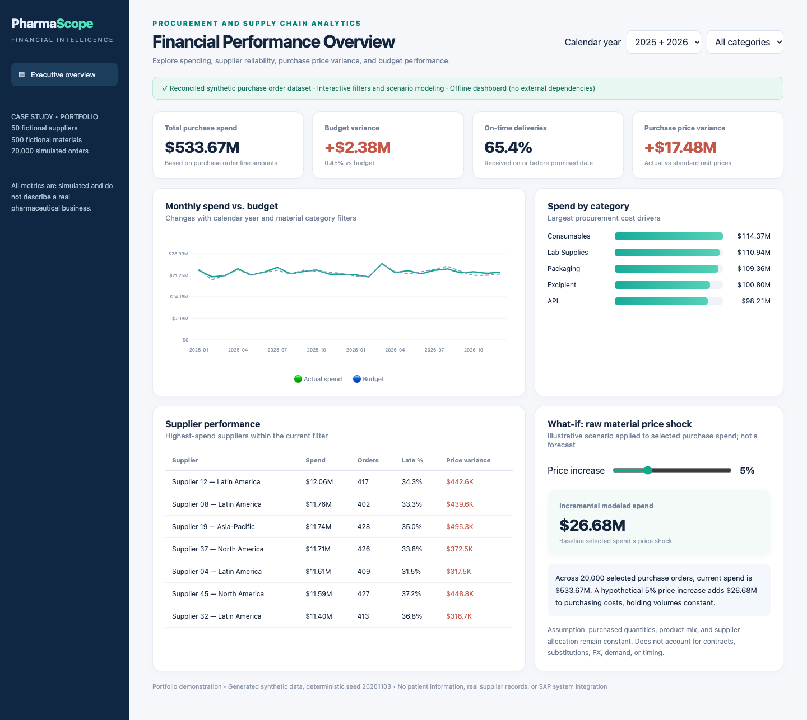

# PharmaScope

### Pharmaceutical supply chain & financial analytics

**20,000 synthetic orders · 50 fictional suppliers · 500 materials · Fully offline dashboard**

A portfolio case study connecting procurement records to finance decisions: where spend exceeds budget, which suppliers deliver late, how purchase prices differ from standards, and what a uniform price increase would cost.



## Try the finished product

Download this repository using **Code → Download ZIP**, extract it, then open [the dashboard](deliverables/PharmaScope_Dashboard.html) in a modern browser. No server, account, installation, subscription, or internet connection is needed. Select a calendar year or category and adjust the price-shock slider.

Open [the financial workbook](deliverables/PharmaScope_Financial_Model.xlsx) in Excel or a compatible spreadsheet application. It contains monthly budget analysis, supplier scorecards, and formula-driven price scenarios. Free compatible applications may render or calculate differently; the workbook has not been tested in every application.

**All records and results are fictional.** This is an educational procurement model, not a validated pharmaceutical operating system. There is no SAP connection, patient information, real supplier data, realized savings, or production compliance claim. The dataset includes the full simulated 2025–2026 period, including dates after the project creation date.

## What is delivered

| Asset | Status |
|---|---|
| Standalone HTML dashboard with filters and scenarios | Included |
| Excel financial model with formulas | Included |
| CSV datasets, SQLite database, SQL queries | Included |
| Deterministic Python data/dashboard build | Included |
| DAX measures, Power Query import template, build guide | Included; templates require manual assembly and verification |
| Native Power BI report (`.pbix`) | **Not included** |
| SAP integration, actual supplier collaboration, operational forecasting | Outside scope |

## Free setup and validation

To explore the product, only a browser is required. To rebuild data and dashboard, use **Python 3.11 or 3.12**, a terminal, and the free packages below. Commands run from the repository root:

```bash
python3 -m venv .venv
source .venv/bin/activate
# Windows PowerShell: .venv\Scripts\Activate.ps1
python -m pip install -r requirements.txt
python src/build_project.py
python src/build_dashboard.py
python tests/test_integrity.py
python tests/test_extended.py
```

The seed is `20261103`. Builds replace generated data and dashboard files in this checkout. CSVs and JSON should reproduce with the pinned packages; SQLite bytes may vary by SQLite version. The checked-in workbook is a separately delivered snapshot: these commands do **not** refresh it. Its original generator, `src/build_financial_model.py`, requires the specialized `artifact_tool` Python runtime used to create the original package; it is not a standard dependency or required for the free data/dashboard workflow. You can inspect/edit the workbook formulas in a compatible spreadsheet app. Do not assume it is refreshed after changing data.

For SQL, use a free SQLite viewer or the SQLite CLI:

```bash
sqlite3 data/pharma_procurement.sqlite < sql/analysis_queries.sql
```

## Read the project

- [Architecture and data flow](docs/ARCHITECTURE.md)
- [Complete data dictionary](docs/DATA_DICTIONARY.md)
- [Financial calculations and assumptions](docs/FINANCIAL_CALCULATIONS.md)
- [Setup, troubleshooting and testing](docs/SETUP_AND_TESTING.md)
- [Executive case study](docs/EXECUTIVE_CASE_STUDY.md)
- [Resume bullets](docs/RESUME_BULLETS.md) and [interview walkthrough](docs/INTERVIEW_GUIDE.md)
- [Power BI assembly and limitations](powerbi/BUILD_GUIDE.md)
- [Roadmap](docs/ROADMAP.md) and [validation report](docs/VALIDATION.md)

## Repository map

```text
src/            Deterministic generator, HTML template, dashboard builder, original workbook builder
 data/          Five CSV datasets and SQLite database (all synthetic)
 deliverables/  Ready-to-open HTML/XLSX, dashboard JSON, reconciled headline metrics
 sql/           Analysis queries
 powerbi/       DAX, Power Query, manual report build guide
 tests/         Dependency-free reconciliation and integration checks
 docs/          Model, setup, portfolio narrative, screenshots, validation
 .github/       Automated data/dashboard build and validation
```

## Design choices and limits

The dashboard embeds summary data so it can run offline without dependencies. Supplier summaries contain year and supplier, but no category grain: the supplier table displays an explanation when a category is selected. Inventory snapshots are available for SQL analysis but are not shown on the dashboard. Positive spend/price variance means above budget/standard; on-time delivery is order-count weighted. Budgets are generated from simulated actual spend, so this is a variance demonstration rather than an independent planning benchmark.

The financial model assumes one line per PO, full delivery, a single illustrative dollar currency, and no tax, FX, partial receipts, payment timing, lot tracking, expiries, or manufacturing consumption. It does not calculate defensible inventory turnover without a consumption/COGS model.

## Contributing and publication

See [CONTRIBUTING.md](CONTRIBUTING.md). Generated data and binaries are small enough for ordinary Git; no LFS is required at current sizes. Never add credentials, personal records, or actual enterprise data. See [SECURITY.md](SECURITY.md). Original synthetic project files are preserved in purpose; improvements are documented in [CHANGELOG.md](CHANGELOG.md). No open-source license has been assigned on the owner's behalf; public visibility alone does not grant a reuse license.
