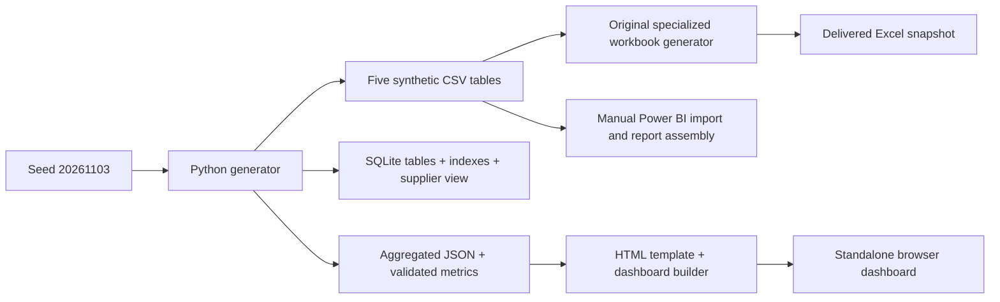

# Architecture

There are no network calls, backend services, accounts, or deployment credentials in the dashboard. `build_project.py` creates dimensions before facts, derives amounts and flags, generates budgets and inventory snapshots, and exports database and summary data. `build_dashboard.py` embeds JSON into one HTML file. The workbook uses monthly/category aggregates and supplier aggregates, with formulas for variances, rates, and scenarios.

## Grain and relationships

- Suppliers: one row per supplier; materials: one per material.
- Purchase orders: one row per synthetic PO, with a supplier and material foreign key. One PO equals one modeled line in this simplified dataset.
- Budget: one row per month/category; inventory: one row per month/material.
- Purchase-order dates determine calendar year/month. Inventory dates are month labels; receipts can fall outside the order year.
- SQLite has indexes and a view but no declared foreign-key constraints; tests enforce relationship integrity.

Never join budget rows directly to individual orders and then sum budget: it would duplicate the budget for every order. Aggregate orders to month/category first, or use conformed dimensions in Power BI. Supplier slicers cannot meaningfully allocate category budgets without an explicit allocation rule. Do not average monthly delivery percentages; aggregate late counts and total order counts first.

## Runtime and storage

Python generates deterministic data locally; the static browser renders native HTML/SVG. Excel and Power BI are independent consumers of the same source data, not live-connected systems. The included workbook remains a snapshot until explicitly rebuilt. No application server or cloud storage is needed.
